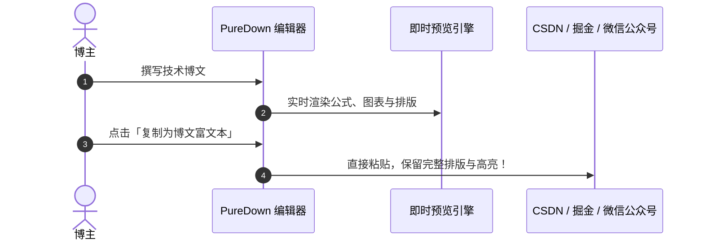

[TOC]

## 引言

计算机语言的世界是丰富多彩的！除了常见的命令式语言（如 C、Python、Swift）以外，还有许多“描述型”语言：用于数据库的 SQL、用于网页的 HTML、用于学术排版的 LaTeX，以及让普通人也能轻松写博客的 **Markdown**。

掌握 Markdown，不仅能让你的笔记更整洁、博客更专业，也是把技术产出、知识沉淀并分享给社区的捷径。

> [!TIP]
> **新版 PureDown** 不仅继承了极速双栏体验，更深度融合了现代化技术博客创作所需的扩展语法：
> YAML Front Matter 元数据卡片、文内 `[TOC]` 自动目录、脚注引用、公式图表、代码 Diff 比较、一键复制博客富文本等。

---

## 一、为什么学 IT 的人必须写技术博客？

1. **增强理解与系统化沉淀**：把学到的知识用文字组织、输出，会迫使你把零散概念系统化，发现自己理解上的薄弱环节，加深记忆。
2. **提升表达与技术说服力**：优秀的工程师不仅能写代码，还能把复杂架构讲清楚。
3. **构建个人作品集**：持续积累的技术博客是你的个人数字资产[^1]。
4. **回馈社区并获得正向反馈**：开源分享不仅能帮助他人，更能通过社区交流获得不同视角的建议。

[^1]: 技术博客作品集在求职、开源合作、同行交流时能强力证明你的思考深度。

---

## 二、现代技术博文必备语法支持

### 1. 文内自动生成目录 [TOC]
在任意位置输入 `[TOC]`，即可自动抽取文章所有小节，生成如上所示的**文内跳转目录树**，与左侧大纲侧边栏完美呼应。

### 2. 代码版本差异比较 (Diff)
讲解技术演进或 Bug 修复时，Diff 语法极其直观：

```diff
- // 旧逻辑：未做缓存比对，每次滚动触发页面全部重绘
- window.renderMarkdown(content);
+ // 新逻辑：比对内容哈希，杜绝不必要的 DOM 刷新与回滚
+ if (mdText !== lastRenderedMarkdown) {
+     lastRenderedMarkdown = mdText;
+     renderDOM(mdText);
+ }
```

### 3. 重点高亮与学术脚注
在技术博客中，我们经常需要强调关键结论：
- 核心法则：==状态单向流动，视图响应变更==。
- 化学分子式与上下标：如水分子 $H_2O$（支持 `H~2~O`）与算法复杂度 $O(n^2)$（支持 `n^2^`）。
- 脚注支持：如文中引用了业界权威规范[^2]，将在文末自动汇总成参考列表。

[^2]: 参考 IEEE / ACM 软件工程系统设计与分布式容灾最佳实践。

---

## 三、算法理论与架构图表

### 1. 数学公式 (KaTeX)
无论是深度学习梯度下降公式：

$$
\theta_{t+1} = \theta_t - \eta \cdot \nabla L(\theta_t)
$$

还是正态分布密度函数：

$$
f(x) = \frac{1}{\sigma \sqrt{2\pi}} e^{-\frac{1}{2}\left(\frac{x-\mu}{\sigma}\right)^2}
$$

### 2. Mermaid 系统架构与时序图



---

## 四、博客发布与导出建议

| 发布平台 | 推荐格式 | PureDown 适配功能 |
| :--- | :--- | :--- |
| **自建博客 (Hexo / Hugo)** | 原生 `.md` | 支持 YAML Front Matter 直接解析 |
| **知乎 / 微信公众号 / 掘金** | 富文本 HTML | 工具栏支持「复制为博文富文本」一键粘贴 |
| **团队分享 / 电子书归档** | PDF 打印 | 专属打印样式优化，代码块不截断 |
| **离线查看** | 独立 HTML | 一键导出完整包含样式的 HTML 文件 |

---

## 结语

选好工具，坚持记录，让写作成为技术人最核心的复利投资！